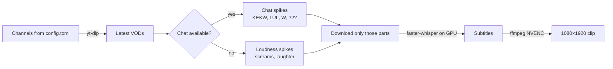

<div align="center">

**🇬🇧 English** · [🇵🇱 Polski](README.pl.md)

# 🎬 stream-clipper

**Turns hours-long streams into ready-to-post vertical clips with subtitles.**
Runs on your own PC and GPU. No API, no subscription, no tokens.

`Twitch` · `YouTube` · `Kick` · any game, any streamer · 1080×1920 · subtitles in ~100 languages

</div>

---

## What you get

Put channels into one file and run `start`. Finished files show up in `out/`:

```
out/
├── tarkov/
│   ├── 012.4x_2931745878_1h23m05s.mp4   ← 9:16 clip with subtitles, ready to upload
│   └── 012.4x_2931745878_1h23m05s.txt   ← caption: what was said, hashtags, source link
└── gta6/
    └── ...
```

The number at the start of the name (`12.4x`) shows how many times stronger than usual chat or audio reacted. Sort by name and the best clips are on top.

## How it works



- **No full VOD downloads.** From an 8-hour stream only the chosen ~45-second parts are fetched. For loudness analysis only the audio is streamed, nothing is saved to disk.
- **Chat moments:** YouTube works out of the box. Twitch works once you add [TwitchDownloaderCLI](#twitch-chat-recommended). Without chat the program picks the loudest moments, so it works with any site yt-dlp supports.
- **Two clip layouts:**
  - **no facecam:** blurred background with the zoomed gameplay in the middle,
  - **with facecam:** streamer's camera on top, gameplay below (the format clipping campaigns usually ask for).
- **Survives missing GPU:** if CUDA or NVENC fails, it switches to the CPU by itself. Slower, but it works.

## Quick start

### Windows 10/11

1. Install Python: open **PowerShell** and type `winget install Python.Python.3.12`.
2. Get the project: **Code → Download ZIP** at the top of this page and unzip it, or `git clone https://github.com/mrmatek11/stream-clipper`.
3. Open `config.toml` in Notepad and add your channels (see [Configuration](#configuration)).
4. Double-click **`start.bat`**.

On the first run the script installs ffmpeg (then open it again), the libraries and the subtitle model (~1.5 GB) by itself. Later runs start right away.

### Kubuntu / Ubuntu / other Linux

```bash
sudo apt install ffmpeg python3-venv git
git clone https://github.com/mrmatek11/stream-clipper && cd stream-clipper
nano config.toml        # add your channels
./start.sh
```

> You only need the NVIDIA driver, which you already have if you game. No CUDA Toolkit needed, the libraries install themselves.

## Configuration

Everything lives in `config.toml`. A group is one output folder: one campaign, one game or one streamer.

```toml
[[group]]
name = "tarkov"
channels = ["twitch:channel_name", "youtube:channel_name", "kick:channel_name"]
keywords = ["tarkov", "eft"]          # only VODs with this in the title ([] = all)
hashtags = "#tarkov #eft #gaming"
facecam = [0.0, 0.7, 0.25, 0.3]       # optional: where the streamer's camera is
```

A new game or streamer is just another `[[group]]` block. Instead of the `twitch:name` shorthand you can paste any channel or playlist link.

### Setting up the facecam

```bash
start.bat --frame https://www.twitch.tv/videos/123456789 --at 600
```

The program saves `out/frame.png`, a frame from the VOD with a red grid every 10%. Read off where the camera starts and how big it is. Example: a camera in the bottom-left corner, 25% wide and 30% tall, is `facecam = [0.0, 0.7, 0.25, 0.3]`, i.e. `[x, y, width, height]`.

## Usage

| Command | What it does |
|---|---|
| `start.bat` / `./start.sh` | processes every channel in every group |
| `start.bat --url <VOD link>` | one specific VOD, good for tuning at the start |
| `start.bat --url <link> --group tarkov` | one VOD with a group's settings (facecam, hashtags, folder) |
| `start.bat --frame <link> --at 600` | gridded frame for setting the facecam |

Processed VODs are recorded in `out/.done`, so you can run it daily and it only picks up new streams. To redo a VOD, delete its line from that file.

### Twitch chat (recommended)

Moments picked from chat are much more accurate than ones picked from loudness. For Twitch:

1. Download **TwitchDownloaderCLI** for your system from [github.com/lay295/TwitchDownloader/releases](https://github.com/lay295/TwitchDownloader/releases).
2. Extract `TwitchDownloaderCLI(.exe)` into the `stream-clipper` folder (or anywhere on your `PATH`).

The program detects it on its own. Without it Twitch still works, based on loudness.

## Tuning

| Symptom | What to change in `config.toml` |
|---|---|
| Too few clips | lower `chat_min_ratio` / `audio_min_ratio` (e.g. 2.0) |
| Too many weak clips | raise them (e.g. 4.0) or lower `clips_per_vod` |
| Clip starts after the action | raise `before` |
| Clip ends too early | raise `after` |
| Gameplay too small | raise `zoom` (e.g. 1.6) |
| Subtitles cover the game HUD | change `margin_v` |
| Subtitles in the wrong language | set `language = "en"` (or `"pl"`, `"ru"`...) |
| Out of VRAM / CUDA error | `whisper_model = "medium"` or `"small"` |
| Files too big | raise `quality` (e.g. 26) |

## Making money: how it really works

The program makes clips, it doesn't make money by itself. The money comes from **clipping campaigns**: a streamer or brand pays per 1,000 views of clips of their content posted to TikTok, YouTube Shorts or Instagram Reels. You'll find campaigns on platforms like Whop (the *Content Rewards* tab) and on streamers' Discords.

- **Only take campaigns and channels you have permission for.** Clips of other people's streams without permission end in copyright strikes and a ban on the account you're growing.
- **Read the campaign rules.** They often require crediting the source (the link is in the `.txt` file), specific hashtags and the facecam layout.
- **Review a clip before posting.** Moments are picked automatically and not every one will be a hit. Post the best ones, the ones with the highest number in the name.
- **Consistency wins:** a few clips a day for weeks, not one big dump.

## Troubleshooting

| Problem | Fix |
|---|---|
| `can't list VODs` | check the channel name; VODs may be subscriber-only. Update yt-dlp: `start` does it on every run |
| `Whisper ... failed` | update the NVIDIA driver. The program carries on on the CPU anyway |
| `h264_nvenc failed` | old driver or ffmpeg without NVENC. The program carries on rendering on the CPU |
| Garbled subtitles on Linux | `sudo apt install fonts-liberation` |
| `0 loud moments` | stream without clear spikes: lower `audio_min_ratio` or add TwitchDownloaderCLI |

Logic test: `python test_clipper.py`.

---

<sub>Unofficial hobby project, not affiliated with Twitch, YouTube, Kick or any game publisher. You are responsible for whose content you clip and publish. MIT license.</sub>
