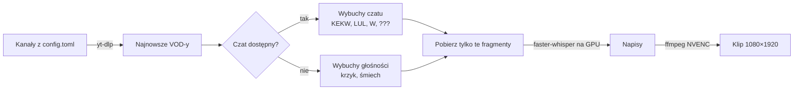

<div align="center">

[🇬🇧 English](README.md) · **🇵🇱 Polski**

# 🎬 stream-clipper

**Z wielogodzinnego streama robi gotowe klipy pionowe z napisami.**
Działa na Twoim komputerze i Twojej karcie graficznej, bez API, abonamentu i tokenów.

`Twitch` · `YouTube` · `Kick` · każda gra i każdy streamer · 1080×1920 · napisy w ~100 językach

</div>

---

## Co dostajesz

Wpisujesz kanały do jednego pliku i klikasz `start`. W folderze `out/` lądują gotowe pliki:

```
out/
├── tarkov/
│   ├── 012.4x_2931745878_1h23m05s.mp4   ← klip 9:16 z napisami, gotowy do wrzucenia
│   └── 012.4x_2931745878_1h23m05s.txt   ← opis: co padło w klipie, hashtagi, link do źródła
└── gta6/
    └── ...
```

Liczba na początku nazwy (`12.4x`) mówi, ile razy mocniej niż zwykle zareagował czat albo dźwięk. Sortujesz po nazwie i najlepsze klipy masz na górze listy.

## Jak to działa



- **Bez pobierania całych VOD-ów.** Z 8-godzinnego streama ściągane są tylko wybrane ~45-sekundowe fragmenty, a do analizy głośności sam dźwięk, strumieniowo, bez zapisu na dysk.
- **Momenty z czatu:** YouTube działa od razu. Twitch działa po zainstalowaniu [TwitchDownloaderCLI](#czat-z-twitcha-zalecane). Bez czatu program wybiera najgłośniejsze momenty, więc działa z każdą stroną, którą obsługuje yt-dlp.
- **Dwa układy klipu:**
  - **bez kamerki:** rozmyte tło i przybliżony gameplay na środku,
  - **z kamerką:** kamerka streamera u góry, gameplay na dole (format, którego zwykle oczekują kampanie klipowania).
- **Odporny na brak GPU:** jeśli CUDA albo NVENC nie działa, sam przełącza się na procesor. Wolniej, ale działa.

## Szybki start

### Windows 10/11

1. Zainstaluj Pythona: otwórz **PowerShell** i wpisz `winget install Python.Python.3.12`.
2. Pobierz projekt: **Code → Download ZIP** na górze tej strony i rozpakuj, albo `git clone https://github.com/mrmatek11/stream-clipper`.
3. Otwórz `config.toml` w Notatniku i wpisz kanały (patrz [Konfiguracja](#konfiguracja)).
4. Kliknij dwa razy **`start.bat`**.

Przy pierwszym uruchomieniu skrypt sam doinstaluje ffmpeg (wtedy otwórz go jeszcze raz), biblioteki i model napisów (~1,5 GB). Kolejne uruchomienia startują od razu.

### Kubuntu / Ubuntu / inne Linuxy

```bash
sudo apt install ffmpeg python3-venv git
git clone https://github.com/mrmatek11/stream-clipper && cd stream-clipper
nano config.toml        # wpisz kanały
./start.sh
```

> Potrzebny jest tylko sterownik NVIDIA, który już masz, jeśli grasz. Toolkit CUDA nie jest potrzebny, biblioteki instalują się same.

## Konfiguracja

Wszystko jest w `config.toml`. Grupa to jeden folder wyjściowy: jedna kampania, jedna gra albo jeden streamer.

```toml
[[group]]
name = "tarkov"
channels = ["twitch:nazwa_kanalu", "youtube:nazwa_kanalu", "kick:nazwa_kanalu"]
keywords = ["tarkov", "eft"]          # bierz tylko VOD-y z tym w tytule ([] = wszystkie)
hashtags = "#tarkov #eft #gaming"
facecam = [0.0, 0.7, 0.25, 0.3]       # opcjonalnie: gdzie jest kamerka streamera
```

Nowa gra albo streamer to kolejny blok `[[group]]`. Zamiast skrótu `twitch:nazwa` możesz wkleić dowolny link do kanału lub playlisty.

### Ustawienie kamerki (`facecam`)

```bash
start.bat --frame https://www.twitch.tv/videos/123456789 --at 600
```

Program zapisze `out/frame.png`, czyli kadr z VOD-a z czerwoną siatką co 10%. Odczytaj z niego, gdzie zaczyna się kamerka i jak jest duża. Przykład: kamerka w lewym dolnym rogu, na 25% szerokości i 30% wysokości, to `facecam = [0.0, 0.7, 0.25, 0.3]`, czyli `[x, y, szerokość, wysokość]`.

## Użycie

| Polecenie | Co robi |
|---|---|
| `start.bat` / `./start.sh` | przetwarza wszystkie kanały ze wszystkich grup |
| `start.bat --url <link do VOD>` | jeden konkretny VOD, dobre na start do strojenia |
| `start.bat --url <link> --group tarkov` | jeden VOD z ustawieniami grupy (kamerka, hashtagi, folder) |
| `start.bat --frame <link> --at 600` | kadr z siatką do ustawienia kamerki |

Przetworzone VOD-y zapisują się w `out/.done`, więc możesz odpalać program codziennie i weźmie tylko nowe streamy. Żeby zrobić VOD jeszcze raz, usuń jego linię z tego pliku.

### Czat z Twitcha (zalecane)

Momenty wybrane z czatu są dużo trafniejsze niż te wybrane z głośności. Dla Twitcha:

1. Pobierz **TwitchDownloaderCLI** dla swojego systemu z [github.com/lay295/TwitchDownloader/releases](https://github.com/lay295/TwitchDownloader/releases).
2. Wypakuj plik `TwitchDownloaderCLI(.exe)` do folderu `stream-clipper` (albo gdziekolwiek w `PATH`).

Program sam go wykryje. Bez niego Twitch też działa, tylko na podstawie głośności.

## Strojenie

| Objaw | Co zmienić w `config.toml` |
|---|---|
| Za mało klipów | obniż `chat_min_ratio` / `audio_min_ratio` (np. 2.0) |
| Za dużo słabych klipów | podnieś je (np. 4.0) albo zmniejsz `clips_per_vod` |
| Klip zaczyna się po akcji | zwiększ `before` |
| Klip urywa się za wcześnie | zwiększ `after` |
| Gameplay za mały | zwiększ `zoom` (np. 1.6) |
| Napisy zasłaniają HUD gry | zmień `margin_v` |
| Napisy w złym języku | ustaw `language = "en"` (albo `"pl"`, `"ru"`...) |
| Brak VRAM / błąd CUDA | `whisper_model = "medium"` albo `"small"` |
| Pliki za duże | podnieś `quality` (np. 26) |

## Zarabianie: jak to wygląda naprawdę

Program robi klipy, ale nie zarabia sam. Pieniądze przychodzą z **kampanii klipowania**: streamer albo marka płaci za każde 1000 wyświetleń klipów z jego treści, wrzuconych na TikTok, YouTube Shorts czy Instagram Reels. Kampanie znajdziesz na platformach typu Whop (zakładka *Content Rewards*) i na Discordach streamerów.

- **Bierz tylko kampanie i kanały, na które masz zgodę.** Klipy z cudzych streamów bez zgody kończą się zgłoszeniami o naruszenie praw autorskich i banem konta, na którym budujesz zasięgi.
- **Czytaj zasady kampanii.** Często wymagają oznaczenia źródła (link jest w pliku `.txt`), konkretnych hashtagów i układu z kamerką.
- **Przejrzyj klip przed wrzuceniem.** Program wybiera momenty automatycznie i nie każdy będzie hitem. Wrzucaj najlepsze, czyli te z najwyższą liczbą w nazwie.
- **Wygrywa regularność:** kilka klipów dziennie przez tygodnie, a nie jeden wielki zrzut.

## Problemy

| Problem | Rozwiązanie |
|---|---|
| `can't list VODs` | sprawdź nazwę kanału; VOD-y mogą być tylko dla subów. Zaktualizuj yt-dlp: `start` robi to sam przy każdym uruchomieniu |
| `GPU Whisper failed` | zaktualizuj sterownik NVIDIA. Program i tak działa dalej na procesorze |
| `h264_nvenc failed` | stary sterownik albo ffmpeg bez NVENC. Program renderuje dalej na procesorze |
| Napisy z krzaczkami na Linuxie | `sudo apt install fonts-liberation` |
| `0 loud moments` | stream bez wyraźnych wybuchów: obniż `audio_min_ratio` albo dodaj TwitchDownloaderCLI |

Test logiki: `python test_clipper.py`.

---

<sub>Nieoficjalny projekt hobbystyczny, niezwiązany z Twitchem, YouTube, Kickiem ani wydawcami gier. Odpowiadasz za to, czyje treści klipujesz i publikujesz. Licencja MIT.</sub>
